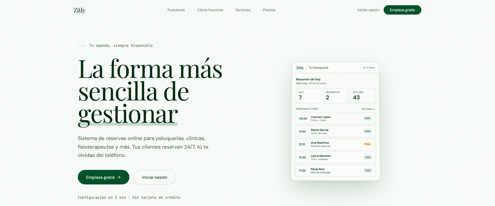
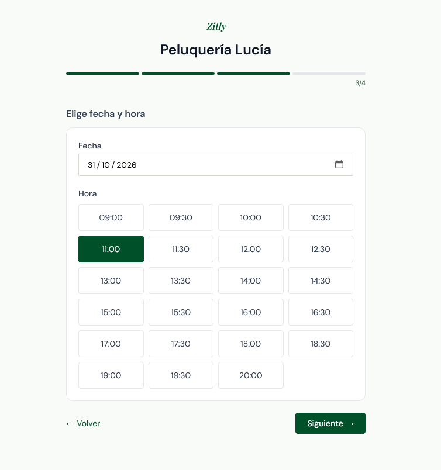
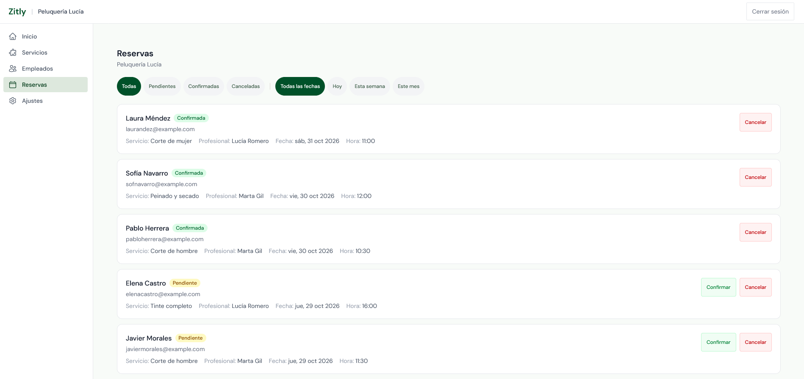

# Zitly

Zitly es una aplicación web de reservas para pequeños negocios: cada negocio comparte un enlace público y sus clientes reservan cita sin necesidad de crear una cuenta.

## Demo

- Aplicación desplegada en Vercel: https://zitly.vercel.app

| Página principal | Reserva como cliente | Panel del dueño |
|---|---|---|
|  |  |  |

## Funcionalidades principales

- **Reserva pública sin cuenta** en `/book/[businessId]`: el cliente elige servicio, profesional, día y hora, e indica nombre y email.
- **Huecos calculados según el horario del negocio**: franjas de 30 minutos entre la hora de apertura y la de cierre, respetando los días activos; los huecos de reservas canceladas vuelven a estar libres.
- **Panel privado** (`/dashboard`) para gestionar servicios, empleados, reservas y ajustes del negocio (datos, horario, contraseña).
- **Gestión de reservas**: el negocio confirma o cancela cada reserva desde el panel.
- **Correos transaccionales**: bienvenida al registrarse, confirmación de reserva y recordatorio el día anterior, con plantillas react-email.
- **Recordatorios automáticos** mediante una tarea programada diaria.
- **Autenticación** con registro, login y recuperación de contraseña, protegidos con CAPTCHA.

## Tecnologías utilizadas

- **Framework:** Next.js 16 (App Router, Server Actions) con React 19 y TypeScript
- **Estilos:** Tailwind CSS 4, lucide-react
- **Base de datos y autenticación:** Supabase (PostgreSQL, Auth, Row Level Security)
- **Correo:** Resend + react-email
- **CAPTCHA:** Cloudflare Turnstile
- **Tests:** Vitest + jsdom
- **Despliegue y cron:** Vercel

## Aspectos técnicos destacados

- **Prevención de dobles reservas en la base de datos.** El índice único parcial `uq_bookings_active_slot` sobre `(business_id, employee_id, date, time) NULLS NOT DISTINCT WHERE status <> 'cancelled'` ([migración 008](supabase/migrations/008_active_booking_slot.sql)) impide dos reservas activas en el mismo hueco, incluso sin empleado asignado, y libera los huecos cancelados. `createBookingAction` hace un único `INSERT` (sin "comprobar y luego insertar", que sería una condición de carrera) y trata el error `23505` de forma explícita; lo mismo hace `updateBookingStatusAction` al reactivar una reserva.
- **RLS y permisos por columna para visitantes anónimos.** Todas las tablas tienen RLS activado con políticas basadas en `auth.uid()`. El rol `anon` solo puede leer de `businesses` las columnas que usa la página de reserva (`id`, `name`, `description`, `opening_time`, `closing_time`) mediante `GRANT SELECT (...)`, de modo que teléfono, email y dirección no se exponen ([migración 009](supabase/migrations/009_anon_businesses_grants.sql)). La política de inserción anónima en `bookings` comprueba además que el servicio y el empleado pertenezcan al negocio indicado ([003](supabase/migrations/003_security_fixes.sql)); la [006](supabase/migrations/006_fix_booking_insert_policies.sql) elimina una política permisiva que la saltaba.
- **Límite de reservas también en la base de datos.** Un trigger (`check_booking_rate_limit`, [004](supabase/migrations/004_security_hardening.sql)) limita a 5 reservas por email y 20 por negocio cada hora, de modo que no se puede esquivar llamando directamente a la API REST de Supabase.
- **Cron de recordatorios en Vercel.** [`vercel.json`](vercel.json) programa `GET /api/cron/reminders` cada día a las 09:00 UTC; la ruta exige `Authorization: Bearer $CRON_SECRET` y envía un recordatorio por cada reserva confirmada del día siguiente.
- **Cliente admin acotado.** El cliente de Supabase que salta RLS solo se usa en el cron y en la reserva pública; el resto del panel trabaja con la sesión del usuario.
- **Captcha con Turnstile** en login, registro y recuperación de contraseña; el token se envía a Supabase Auth, que lo valida.
- **Protección de rutas** con `src/proxy.ts` (convención de Next.js 16), que valida la sesión contra Supabase en cada petición al dashboard.
- **Cabeceras de seguridad** (CSP, HSTS, `X-Frame-Options`, etc.) definidas en `next.config.ts`.
- **Integridad al borrar:** no se pueden eliminar servicios ni empleados con reservas activas.
- **Errores de base de datos nunca llegan al cliente**: las Server Actions devuelven mensajes genéricos.
- **Tests:** 140 tests en 8 archivos (Vitest) sobre Server Actions y utilidades, incluyendo los conflictos de la restricción única en reservas.

## Instalación en local

Requisitos: Node.js y un proyecto de Supabase con **PostgreSQL 15 o superior** (la migración 008 usa `NULLS NOT DISTINCT`).

1. Clona el repositorio e instala dependencias:
   ```bash
   git clone https://github.com/perezlopezalej/zitly.git
   cd zitly
   npm install
   ```
2. Copia `.env.example` a `.env.local` y rellena los valores:
   ```bash
   cp .env.example .env.local
   ```

   | Variable | Obligatoria | Uso |
   | --- | --- | --- |
   | `NEXT_PUBLIC_SUPABASE_URL` | Sí | URL del proyecto Supabase |
   | `NEXT_PUBLIC_SUPABASE_ANON_KEY` | Sí | Clave publishable/anon |
   | `SUPABASE_SERVICE_ROLE_KEY` | Sí | Clave secret/service_role (solo servidor) |
   | `CRON_SECRET` | Sí | Secreto Bearer del cron de recordatorios |
   | `RESEND_API_KEY` | No | Si falta, los correos se omiten |
   | `NEXT_PUBLIC_APP_URL` | No | Enlaces en correos (por defecto `http://localhost:3000`) |
   | `NEXT_PUBLIC_TURNSTILE_SITE_KEY` | No | CAPTCHA en login, registro y recuperación |

3. Ejecuta las migraciones de `supabase/migrations/` **en orden** (por ejemplo, pegándolas en el SQL Editor de Supabase): `001` → `002` → `003` → `004` → `005` → `006` → `007` → `008` → `009`.
4. Arranca el servidor de desarrollo:
   ```bash
   npm run dev
   ```
   La app queda en <http://localhost:3000>.
5. Opcional: `npx vitest run src/app/actions/__tests__/booking.test.ts` para lanzar un archivo de tests, o `npm run build` para comprobar la compilación de producción.

## Nota sobre los correos

Los correos funcionan en **modo demo** y hay dos tipos:

- **Correos de cuenta** (registro y recuperación de contraseña): los envía Supabase Auth con SMTP propio y llegan a cualquier dirección.
- **Correos de reservas y recordatorios**: van por Resend en modo demo, sin dominio propio, así que solo llegan a la dirección de la cuenta de Resend.

## Retos y aprendizajes

**Un error que solo veían los clientes.** La página de reservas daba 404 a los visitantes
sin sesión, pero a mí me funcionaba porque entraba como dueño. La causa era que una
migración había retirado los permisos de lectura a nivel de tabla para el rol anónimo, y
las columnas de horario, añadidas después, nunca recibieron permiso. Lo diagnostiqué
consultando los privilegios reales en la base de datos y lo corregí concediendo solo las
columnas que necesita la página. Aprendí a probar siempre como lo haría un usuario real,
no solo como administrador.

**Evitar dobles reservas.** La restricción UNIQUE original tenía dos fallos: no protegía
las reservas sin empleado asignado (en Postgres, dos NULL no se consideran iguales) y las
reservas canceladas seguían ocupando el hueco. Además, el código comprobaba primero si el
hueco estaba libre y después insertaba, lo que falla si dos personas reservan a la vez.
Lo sustituí por un índice único parcial con `NULLS NOT DISTINCT` que ignora las canceladas,
para que sea la base de datos quien decida, y añadí tests para los casos de conflicto.

**Migraciones que no coincidían con producción.** Algunas columnas se habían creado a mano
en Supabase y no estaban en las migraciones, así que la app no se podía instalar desde
cero. Antes de escribir las migraciones nuevas comprobé el esquema real y descubrí que
varias columnas tenían otro tipo del que suponía, así que ajusté las migraciones a
producción en lugar de al revés.

**Operar en planes gratuitos.** Supabase pausa los proyectos inactivos, y la app dejaba de
funcionar sin avisar. El cron diario de recordatorios ahora consulta la base de datos en
cada ejecución, lo que la mantiene activa, y protegí su endpoint para que rechace cualquier
llamada sin el secreto configurado.

## Autor

**Alejandro Pérez López**

- GitHub: [perezlopezalej](https://github.com/perezlopezalej)
- LinkedIn: [Alejandro Pérez López](https://www.linkedin.com/in/alejandro-alejandro-perez-dev/)

## Licencia

© 2026 Alejandro Pérez López. Todos los derechos reservados. El código es público solo para consulta; para usarlo o adaptarlo, contacta con el autor.
